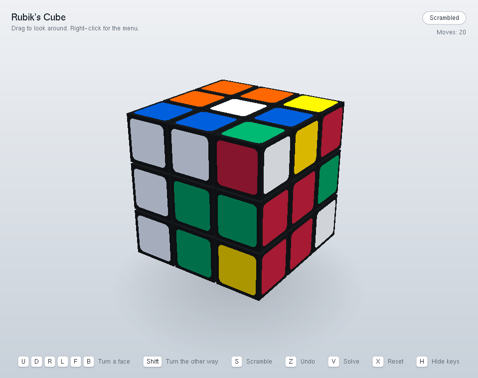
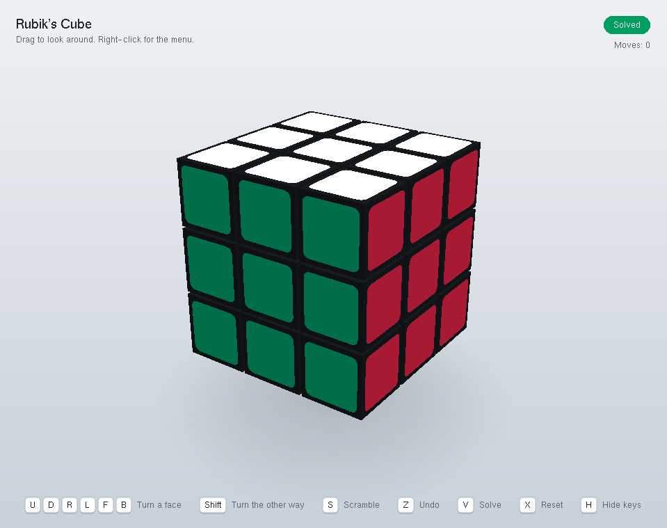
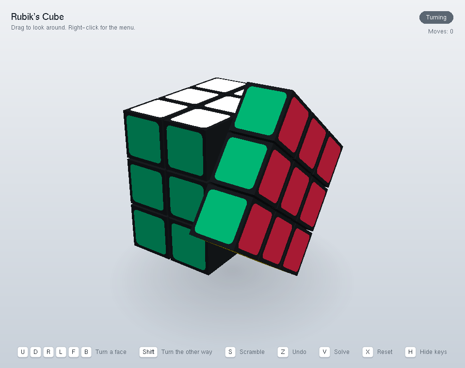
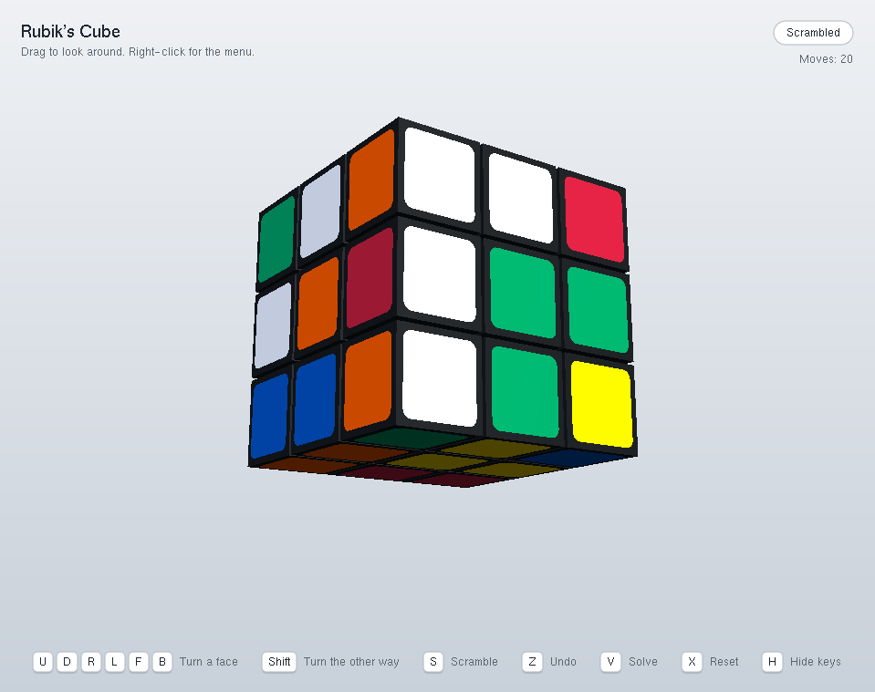
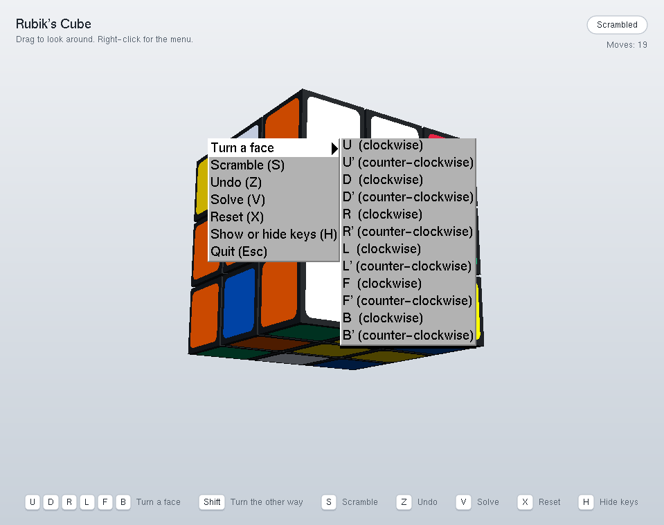
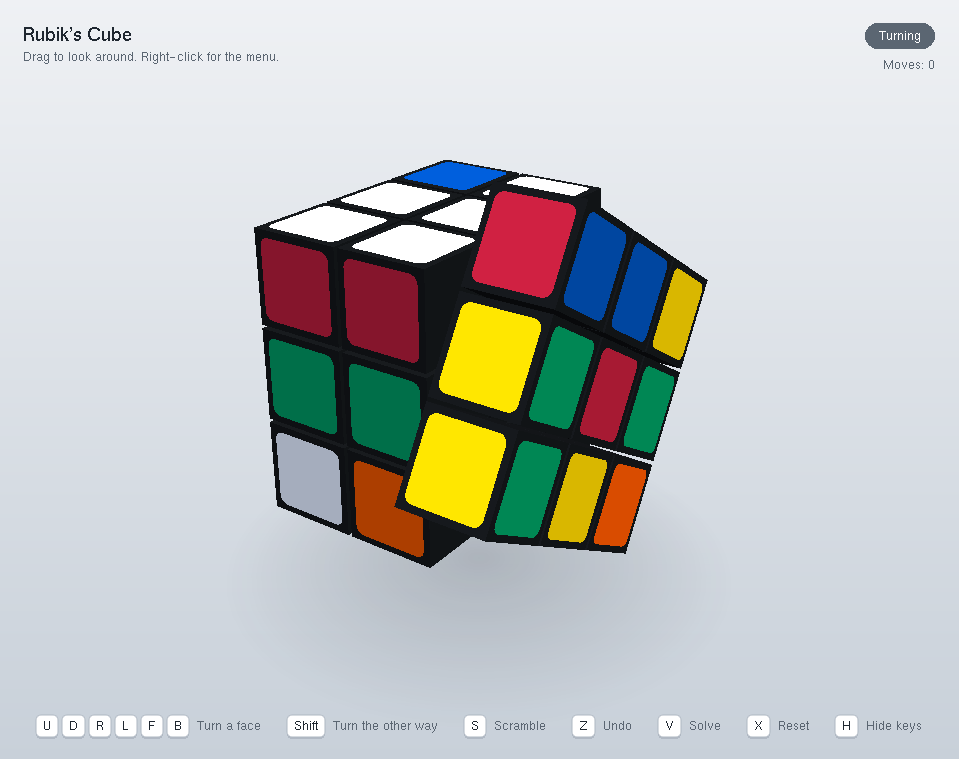
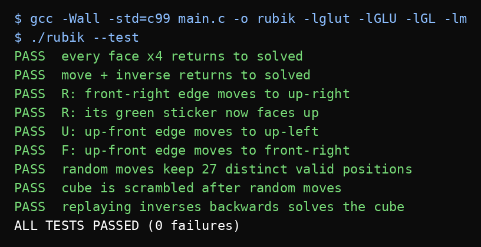

# Rubix

**An interactive 3D Rubik's Cube you can turn, scramble, undo and solve, written in C with OpenGL.**

Rubix renders a full 3×3 cube with rounded stickers, a soft contact shadow and smooth 90° turn animations.
You drag to look around, press a key to turn a face, and watch it scramble itself or play the moves back
to solved. Everything lives in one readable C file, built for a Computer Graphics & Visualization lab mini
project.

<p align="center">
  
</p>

## Features

- All six faces turn both ways using standard cube notation (U, D, R, L, F, B)
- Smooth animated turns at about 60 fps, with queued moves so fast key presses never get lost
- Scramble with 20 random moves, undo one move at a time, or solve by replaying the history backwards
- Drag with the mouse to orbit the cube from any angle
- On-screen key legend (toggle with **H**), a status pill and a move counter
- Right-click menu with the same actions
- A built-in self-test that checks the cube maths without opening a window

## Controls

| Input | Action |
|---|---|
| Left mouse drag | Rotate the view |
| `U` `D` `R` `L` `F` `B` | Turn that face clockwise |
| `Shift` + face key | Turn it counter-clockwise |
| `S` | Scramble (20 random moves) |
| `Z` | Undo the last move |
| `V` | Solve (replays your moves backwards) |
| `X` | Reset to solved |
| `H` | Show or hide the key legend |
| Right click | Menu |
| `Esc` | Quit |

Faces are fixed to the cube, not the screen: U is white, D yellow, R red, L orange, F green and B blue.

## Screenshots

| Solved | Mid-turn | View rotated |
|---|---|---|
|  |  |  |
| **Right-click menu** | **Solving** | **Self-test** |
|  |  |  |

More in [`report-screenshots/`](report-screenshots/).

## Building and running

You need a C compiler and freeglut (or any GLUT).

**Code::Blocks (Windows):** open `Rubix.cbp` and press **Build and run**. The project already links
`freeglut`, `opengl32` and `glu32`; make sure `freeglut.dll` sits next to the exe or on your PATH.

**Command line, Windows (MinGW):**
```
gcc -Wall -std=c99 main.c -o Rubix -lfreeglut -lopengl32 -lglu32
Rubix
```

**Command line, Linux:**
```
sudo apt install freeglut3-dev
gcc -Wall -std=c99 main.c -o rubik -lglut -lGLU -lGL -lm
./rubik
```

## Self-test

```
./rubik --test
```

Runs nine checks with no window: every face turned four times returns to solved, a move plus its inverse
cancels out, the R, U and F turns move pieces the way a real cube does, 200 random moves keep all 27 pieces in
valid, distinct positions, and replaying those moves backwards solves the cube.

## How it works

- **Cube model:** 27 small cubes ("cubies"). Each stores its current position (each coordinate is -1, 0 or +1),
  its home position, which decides its sticker colours, and a 3×3 rotation matrix for its orientation.
- **Turning a face:** a turn picks the cubies in one layer and rotates their positions and orientation matrices
  by 90° with integer maths, so the cube never drifts out of alignment.
- **Animation:** while a turn is playing, that layer is drawn rotated by a growing angle over 18 frames, then
  the move is committed to the model. Further moves wait in a queue.
- **Undo and solve:** every move goes on a history stack. Undo pops one move and plays its inverse; solve plays
  the whole history back in reverse. It's a replay, not a solving algorithm like CFOP or Kociemba.
- **Rendering:** legacy fixed-function OpenGL with lighting, anti-aliasing when the GPU supports it, rounded
  sticker geometry and a blurred contact shadow. The legend and status overlay are drawn in a 2D pass on top.

## Project layout

```
main.c               the whole program: model, moves, animation, rendering, input, self-test
Rubix.cbp            Code::Blocks project
report-screenshots/  screenshots used in the report and this README
cg report.docx       mini project report
```

## Ideas for later

- A real solver (layer by layer, or Kociemba's two-phase algorithm) so it can solve any scramble you make by hand
- Turning faces by dragging on the cube itself
- Bigger cubes (4×4, 5×5)
- A timer and move history panel for speedcubing practice
